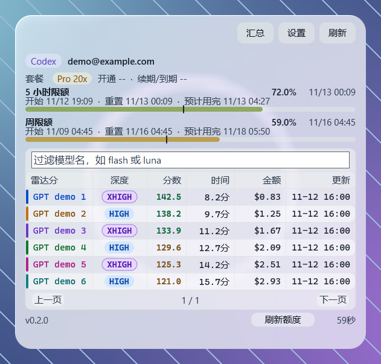
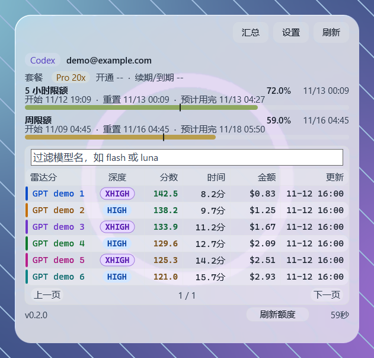
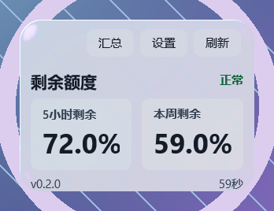
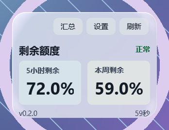
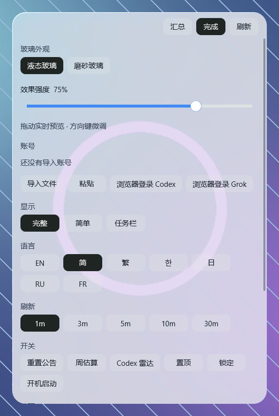
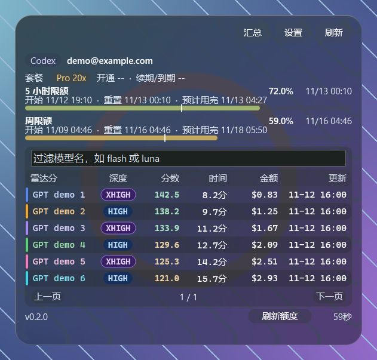
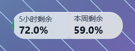

# CodexUsageBar

原生 `Win32/C++` 的 Codex 用量桌面挂件，面向 Windows，支持实时液态玻璃和磨砂玻璃。

[English README](README.md)
[](https://linux.do/)

## 项目看板

[](https://github.com/luodaoyi/codex-useage-win/actions/workflows/build.yml)
[](https://github.com/luodaoyi/codex-useage-win/releases/latest)
[](https://github.com/luodaoyi/codex-useage-win/releases/latest)
[](https://github.com/luodaoyi/codex-useage-win/releases)
[](https://github.com/luodaoyi/codex-useage-win/stargazers)

它会读取当前 Codex 账号的限额信息，在桌面上显示一个可拖动、可缩放的固定布局面板，用来观察：

- `5 小时限额` 已用/剩余
- `每周限额` 已用/剩余
- `当前周期理论应使用多少`
- `实际已经使用多少`
- `当前高于/低于平均进度`
- `距离重置还剩多久`
- `上次成功刷新时间`
- `距离下一次自动刷新还剩多久`

## 示例

### 磨砂玻璃（含智能评分）



### 液态玻璃



### 简单模式：液态与磨砂





### 外观设置



### 深色玻璃与任务栏模式





以上图片均为程序在 Windows 上实际运行的截图，背景由截图工具生成，用量和排名使用离线示例数据。图中的模型名称及分数仅用于展示布局。

## 玻璃外观

打开**设置 → 玻璃外观**，或右键点击挂件。选择**液态玻璃**可以看到更明显的边缘折射和色散；选择**磨砂玻璃**可以获得更柔和的模糊背景。拖动 **0–100% 效果强度滑条**即可实时预览。点击滑条后，方向键每次调整 1%，Home / End 调整至两端。材质和强度保存在程序旁 `settings.ini` 的 `[appearance]` 段。设置页支持滚轮滚动，以便在小屏幕上访问其余选项。

程序使用 Direct3D 11、DirectComposition 和自定义着色器处理窗口背后的真实画面，再通过 Direct2D 绘制清晰的文字和图表。主次文字使用更强的对比，彩色数据会调整明暗，玻璃也会限制内容区的背景亮度，避免复杂图片淹没小字。这些处理参考了 Apple 的[材质](https://developer.apple.com/design/human-interface-guidelines/materials)与[颜色](https://developer.apple.com/design/human-interface-guidelines/color)指南，具体效果由 Windows 渲染器实现。

需要 Windows 10 2004 或更新版本，以及支持 Direct3D 11 的显卡。如果桌面采集暂不可用，例如进入安全桌面或采集被拒绝，程序会显示实色面板，在外观设置中提示，并稍后重试。为避免玻璃采集到自身，程序会将窗口排除在 DXGI Desktop Duplication 之外，因此使用该接口的远控或录屏软件可能看不到挂件；需要使用兼容排除方式的系统，还可能在其他截图工具中隐藏挂件。挂件跨屏移动时会切换当前显示器，不会将两个显示器拼接进同一块玻璃。

如需重新生成全部截图，请先构建 Release，安装 Pillow，然后运行 `python tools/capture_readme.py`。脚本使用 `--preview` 启动示例界面，并检查滑条实时变化、键盘端点和设置页滚动。

## 功能

- 原生 `Win32 + Direct3D 11 + DirectComposition + Direct2D + DirectWrite + WinHTTP`
- 可配置液态／磨砂玻璃，支持 0–100% 实时效果滑条
- 无 `C#`、无 `WebView`
- 运行时只读取可执行文件同目录的 `accounts\*.json`（一账号一文件）。右键「账号 → 导入…」选择凭证文件后，程序把该文件复制进 `accounts\`，不修改原文件。右键切换已导入账号。当前选择记在可执行文件同目录 `settings.ini` 的 `active_auth`
- 同时接受 Codex 原生（`tokens.access_token`）和 CPA 导出的扁平文件（顶层 `access_token` / `id_token` / `refresh_token`，`type` 为 `codex`）
- 请求 `GET https://chatgpt.com/backend-api/wham/usage`
- 支持通过环境变量配置请求级 HTTP(S) 代理（不改系统全局代理）
- 三种显示模式：
  - 标准模式：套餐与重置卡、限额进度条、底部刷新按钮（重置额度改走右键菜单）
  - 简单模式：只显示 `5小时剩余`、`本周剩余` 和状态标签，适合更紧凑的小卡片
  - 任务栏模式：更小的剩余额度小条，自动贴近当前显示器的任务栏边缘，并固定贴边显示
- 智能评分排名（默认关闭）：
  - 雷达分：GPT 读取 `https://codexradar.com/data/codex-four-task-results.json`，按发布的权重计算四项总分（满分 150），费用与耗时为四项合计，更新列显示成绩快照时间。拉取失败后 30 秒再试，成功后每 5 分钟刷新。不同模型使用明显不同的颜色，面板不再显示来源链接
  - 按分数倒序，只显示 GPT，保留名称输入框过滤，不显示模型选择按钮
  - 每页 10 条，支持上一页 / 下一页
- 桌面浮层挂件，可拖动、可缩放
- 根据当前进度状态切换颜色
- 支持开机自启开关
- 支持 `Always on top` 置顶开关
- 支持 `Lock position` 固定位置开关
- 支持 `完整模式` / `简单模式` / `任务栏模式` 显示模式切换
- 支持中英文界面切换

玻璃渲染参考了采用 MIT 许可证的 [Atrium Desktop](https://github.com/wynter-yaxley/atrium-desktop)，许可证说明见[第三方声明](THIRD_PARTY_NOTICES.md)。

## 刷新策略

- 远程用量接口：每 `60` 秒刷新一次
- 智能评分：开启后每 `5` 分钟刷新一次
- 本地倒计时：每 `1` 秒重绘一次
- 右下角显示：
  - 上次成功刷新时间
  - 距离下一次自动刷新的倒计时
- 右键 `立即刷新`：立即强制刷新用量；评分开启时一并刷新雷达数据

## 使用方式

- 拖动挂件主体：移动位置
- 拖右边、下边、右下角：调整大小
- 任务栏模式固定贴边显示，不支持拖动或缩放
- 右键菜单：
  - `立即刷新`
  - `刷新 Token`
  - `重置额度…`（额度重置主入口；需连续确认两次后再弹窗最终确认）
  - `开机自启`
  - `始终置顶`
  - `固定位置`
  - `显示模式`
  - `智能评分排名`：`关闭` / `雷达分`
  - `语言`
  - `重置组件位置`
  - `退出`
- 评分面板：点击 `全部` 或具体模型按钮多选过滤；用 `上一页` / `下一页` 翻页

位置和尺寸会保存到：

- 可执行文件同目录的 `settings.ini`

开机自启使用当前用户注册表：

- `HKCU\Software\Microsoft\Windows\CurrentVersion\Run`

## HTTP(S) 代理

如需在不设置 Windows 系统全局代理的情况下访问用量接口，可设置进程环境变量（优先级从高到低）：

- `HTTPS_PROXY` / `https_proxy`
- `HTTP_PROXY` / `http_proxy`

可选绕过列表：

- `NO_PROXY` / `no_proxy`（逗号或分号分隔）

示例（当前用户会话）：

```cmd
set HTTPS_PROXY=http://127.0.0.1:7890
CodexUsageBar.exe
```

说明：

- 代理只作用于本程序的 WinHTTP 请求，不会修改系统代理设置
- `accounts\*.json` 是复制进来的登录凭据，与代理配置无关。原 `auth.json` 不会被直接读取或写回

## 本地构建

### 直接构建

```cmd
build.cmd
```

输出文件：

- `CodexUsageBar.exe`

### 使用 CMake

```powershell
cmake -S . -B build -G "Visual Studio 17 2022" -A x64
cmake --build build --config Release
```

## GitHub Actions

仓库包含自动构建和自动发布工作流。

### 自动构建

- 平台：
  - `x64`
  - `ARM64`
- 触发方式：
  - 推送到 `main` / `master`
  - `pull_request`
  - `workflow_dispatch`

### 自动发布 Release

- 触发方式：
  - 推送版本标签，例如 `v0.1.0`
- 行为：
  - 自动构建 `x64` 和 `ARM64`
  - 自动创建 GitHub Release
  - 自动上传：
    - `CodexUsageBar-x64.exe`
    - `CodexUsageBar-ARM64.exe`

## 发布流程

```bash
git tag v0.1.0
git push origin master
git push origin v0.1.0
```

如果默认分支改成了 `main`，把上面的 `master` 换成 `main` 即可。

## 已知限制

- 临近过期或遇到 401/403 时会用 `refresh_token` 续期，并写回当前账号那一份凭证文件
- 如果 OpenAI 后端接口字段变化，需要同步调整解析逻辑
- 当前是桌面浮层挂件，不是 Windows 7 时代的官方 Gadget 平台

## Star History

<a href="https://www.star-history.com/?repos=luodaoyi%2Fcodex-useage-win&type=timeline&logscale=&legend=top-left">
 <picture>
   <source media="(prefers-color-scheme: dark)" srcset="https://api.star-history.com/chart?repos=luodaoyi/codex-useage-win&type=timeline&theme=dark&logscale&legend=top-left" />
   <source media="(prefers-color-scheme: light)" srcset="https://api.star-history.com/chart?repos=luodaoyi/codex-useage-win&type=timeline&logscale&legend=top-left" />
   
 </picture>
</a>
