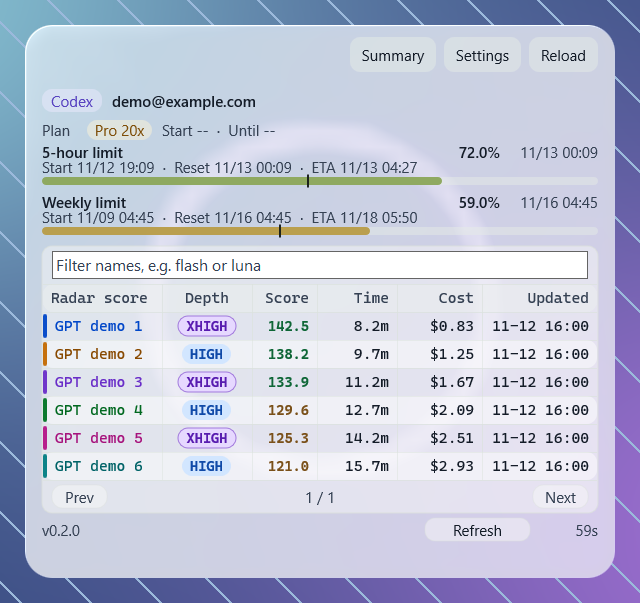
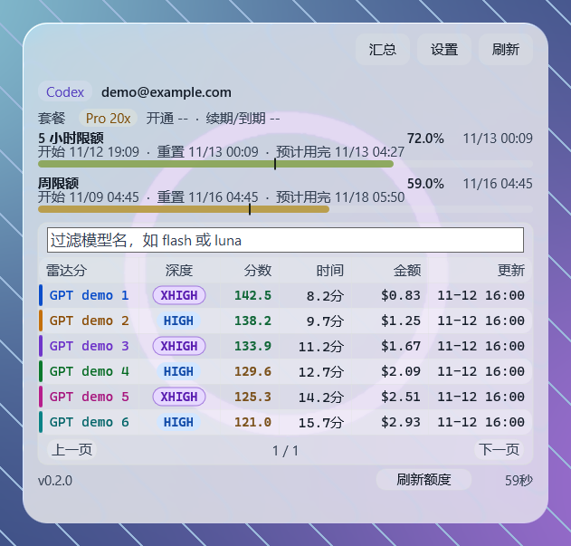
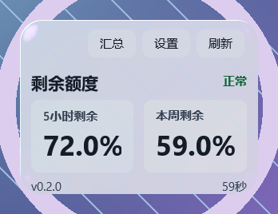
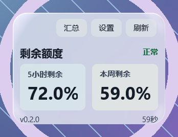
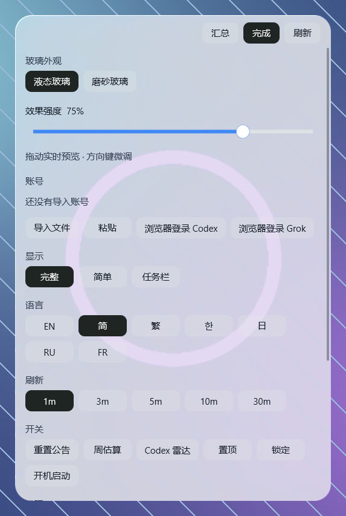
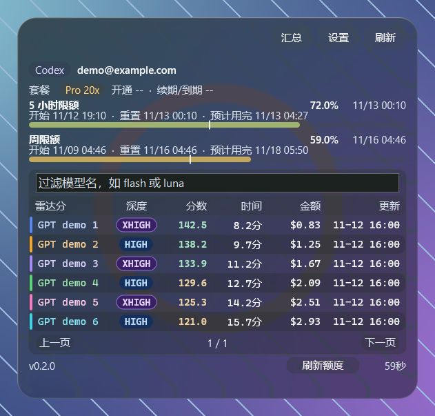
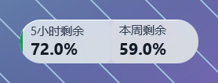

# CodexUsageBar

A native `Win32/C++` desktop widget for Windows with real-time liquid and frosted glass, showing your Codex usage budget at a glance.

[中文说明](README-zh.md)
[](https://linux.do/)

## Project Status

[](https://github.com/luodaoyi/codex-useage-win/actions/workflows/build.yml)
[](https://github.com/luodaoyi/codex-useage-win/releases/latest)
[](https://github.com/luodaoyi/codex-useage-win/releases/latest)
[](https://github.com/luodaoyi/codex-useage-win/releases)
[](https://github.com/luodaoyi/codex-useage-win/stargazers)

The widget reads usage limits from the current Codex account and displays them in a draggable, resizable desktop panel. It helps you monitor:

- `5-hour quota` used and remaining
- `Weekly quota` used and remaining
- `Expected usage` for the current point in the cycle
- `Actual usage`
- `Ahead of pace` or `behind pace`
- `Time until reset`
- `Last successful refresh`
- `Time until the next automatic refresh`

## Screenshots

### Frosted Glass (with smart ranking)



### Liquid Glass



### Simple Mode — Liquid and Frosted





### Appearance Settings



### Dark Glass and Taskbar Mode





These are captures of the running Windows app over a generated backdrop, with offline sample usage and ranking data. The model names and scores in these screenshots are illustrative.

## Glass Appearance

Open **Settings → Glass appearance**, or right-click the widget. Choose **Liquid glass** for stronger edge refraction and dispersion, or **Frosted glass** for a softer, more blurred backdrop. Drag **Effect strength** from 0–100% to preview changes immediately; click the slider and use the arrow keys for 1% steps, or Home/End for the endpoints. The material and strength are saved beside the executable in `settings.ini` under `[appearance]`. Scroll the settings page to reach the remaining options.

The glass uses Direct3D 11, DirectComposition and a custom shader. It samples the real screen behind the widget, while Direct2D draws crisp text and charts above it. Text uses stronger primary/secondary colors; colored data is adjusted for contrast, and the glass bounds its background luminance to keep dense information readable. This follows the legibility principles in Apple's [Materials](https://developer.apple.com/design/human-interface-guidelines/materials) and [Color](https://developer.apple.com/design/human-interface-guidelines/color) guidance; it is a custom Windows implementation.

Windows 10 version 2004 or later and a Direct3D 11-capable GPU are required. If desktop capture is unavailable (for example, on the secure desktop or when capture is denied), the widget shows an opaque surface and reports this in Appearance settings, then retries capture. The widget is excluded from DXGI Desktop Duplication to prevent recursive feedback, so remote-control/recording software using that API may omit it. On systems that require the capture-exclusion fallback, other capture tools may omit it too. Moving a widget across monitors samples its current monitor; it does not stitch two monitors inside one widget.

To reproduce all screenshots after a Release build, install Pillow and run `python tools/capture_readme.py`. The script starts `--preview` instances with sample data and checks the live material slider, keyboard endpoint and settings scrolling.

## Features

- Native `Win32 + Direct3D 11 + DirectComposition + Direct2D + DirectWrite + WinHTTP`
- Configurable liquid/frosted glass with a live 0–100% effect slider
- No `C#`, no `WebView`
- Runtime reads only `accounts\*.json` next to the executable (one file per account). Account → Import… copies the chosen auth file into `accounts\` and does not modify the source. Switch imported accounts from that menu. The choice is `active_auth` in `settings.ini` next to the executable
- Accepts both native Codex auth (`tokens.access_token`) and a flat CPA export (`access_token` / `id_token` / `refresh_token` at the root, `type` = `codex`)
- Requests `GET https://chatgpt.com/backend-api/wham/usage`
- Optional request-level HTTP(S) proxy via env vars (does not change the system proxy)
- Three display modes:
  - Standard mode: plan and reset-credit inventory, remaining bars, and a refresh button (reset credits moved to the right-click menu)
  - Simple mode: compact `5h left` and `Week left` cards with remaining percentages and status text
  - Taskbar mode: a smaller remaining-quota strip that snaps near the current monitor's taskbar edge and stays docked there
- Smart ranking (off by default):
  - Radar score: GPT reads `https://codexradar.com/data/codex-four-task-results.json` and uses the published weights for the four-task total out of 150. Cost and time are totals across all four tasks; the update column shows the score snapshot time. A failed fetch retries after 30 seconds; a successful fetch refreshes every 5 minutes. The panel assigns distinct colors to models and has no source link
  - Only GPT models are shown, sorted by score. The name box still filters; model selection buttons are hidden
  - 10 rows per page with Prev / Next
- Desktop overlay widget with drag and resize support
- Dynamic coloring based on current pace
- Launch at startup toggle
- Always-on-top toggle
- Lock-position toggle
- Display mode switch for full, simple, and taskbar layouts
- UI language switch between English and Chinese

Glass rendering draws on the MIT-licensed [Atrium Desktop](https://github.com/wynter-yaxley/atrium-desktop) implementation. See [third-party notices](THIRD_PARTY_NOTICES.md).

## Refresh Behavior

- Remote usage API refresh: every `60` seconds
- Smart ranking refresh: every `5` minutes when enabled
- Local countdown repaint: every `1` second
- Bottom-right area shows:
  - last successful refresh time
  - countdown to the next automatic refresh
- Right-click menu `Refresh now`: force-refresh usage, and radar scores if ranking is on

## Usage

- Drag the widget body to move it
- Drag the right edge, bottom edge, or bottom-right corner to resize it
- Taskbar mode stays docked and does not support dragging or resizing
- Right-click menu:
  - `Refresh now`
  - `Refresh token`
  - `Reset credits...` (primary reset-credit entry; arm twice, then a final MessageBox)
  - `Launch at startup`
  - `Always on top`
  - `Lock position`
  - `Display mode`
  - `Smart ranking`: `Off` / `Radar score`
  - `Language`
  - `Reset widget position`
  - `Exit`
- Ranking panel: click `All` or a model chip to multi-select; use `Prev` / `Next` to page

Position and size are stored in:

- `settings.ini` next to the executable

Startup registration uses the current user registry key:

- `HKCU\Software\Microsoft\Windows\CurrentVersion\Run`

## HTTP(S) Proxy

To fetch usage through a proxy without changing the Windows system proxy, set process environment variables (high → low priority):

- `HTTPS_PROXY` / `https_proxy`
- `HTTP_PROXY` / `http_proxy`

Optional bypass list:

- `NO_PROXY` / `no_proxy` (comma or semicolon separated)

Example:

```cmd
set HTTPS_PROXY=http://127.0.0.1:7890
CodexUsageBar.exe
```

Notes:

- Proxy applies only to this app's WinHTTP requests
- `accounts\*.json` holds copied credentials only and is separate from proxy settings. The original `auth.json` is neither read nor written at runtime

See also [README-zh.md](README-zh.md).

## Build Locally

### Direct Build

```cmd
build.cmd
```

Output:

- `CodexUsageBar.exe`

### Build with CMake

```powershell
cmake -S . -B build -G "Visual Studio 17 2022" -A x64
cmake --build build --config Release
```

## GitHub Actions

The repository includes automated build and release workflows.

### Build Workflow

- Platforms:
  - `x64`
  - `ARM64`
- Triggers:
  - push to `main` / `master`
  - `pull_request`
  - `workflow_dispatch`

### Release Workflow

- Trigger:
  - push a version tag such as `v0.1.0`
- Behavior:
  - build `x64` and `ARM64`
  - create a GitHub Release automatically
  - upload:
    - `CodexUsageBar-x64.exe`
    - `CodexUsageBar-ARM64.exe`

## Release Flow

```bash
git tag v0.1.0
git push origin master
git push origin v0.1.0
```

If the default branch is `main`, replace `master` with `main`.

## Known Limitations

- Near expiry, or on HTTP 401/403, it refreshes with `refresh_token` and writes the new tokens back to that account's own file
- If the OpenAI backend response changes, the parser must be updated accordingly
- This is a desktop overlay widget, not the legacy Windows Gadget platform

## Star History

<a href="https://www.star-history.com/?repos=luodaoyi%2Fcodex-useage-win&type=timeline&logscale=&legend=top-left">
 <picture>
   <source media="(prefers-color-scheme: dark)" srcset="https://api.star-history.com/chart?repos=luodaoyi/codex-useage-win&type=timeline&theme=dark&logscale&legend=top-left" />
   <source media="(prefers-color-scheme: light)" srcset="https://api.star-history.com/chart?repos=luodaoyi/codex-useage-win&type=timeline&logscale&legend=top-left" />
   
 </picture>
</a>
